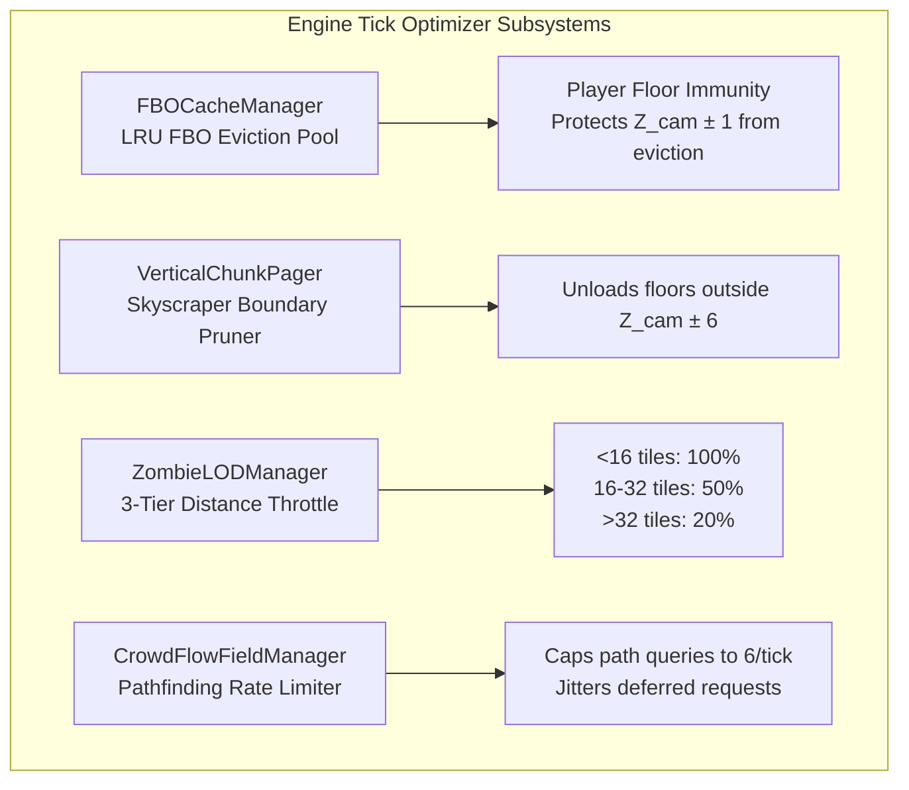

# Engine Tick Optimizer (ETO) for Project Zomboid (Build 42)

**Version:** `0.1.0-alpha` (WIP) | [Changelog](CHANGELOG.md)

> **High-Performance Macro-Engine Optimization and VRAM Reclamation for Project Zomboid Build 42.**  
> Eliminates runaway RAM/VRAM leaks, stabilizes high-density Louisville horde combat, and brings Build 42 memory consumption back down to Build 41 levels (~4 GB).

---

## The Build 42 Performance Bottleneck

Project Zomboid Build 42 introduces high-rise buildings and vertical streaming, introducing several resource bottlenecks:
1. **The 32-Level FBO VRAM Leak:** Build 42 supports vertical skyscraper worlds up to 32 Z-levels (`IsoChunkLevel`). Chunk floors are baked into offscreen Frame Buffer Objects (`FBORenderChunk`). In dense cities like Louisville, these FBOs persist indefinitely in VRAM, causing memory usage to rapidly spiral from 4 GB to **9+ GB**, eventually saturating 100% of physical system RAM (especially critical on APU/integrated graphics laptops where VRAM is shared physical memory).
2. **Louisville Horde Repath Stutters:** When gunshots or car alarms trigger 50+ zombies simultaneously, the engine floods the native C++ pathfinding thread with concurrent navigation queries, causing severe multi-frame freezing.
3. **Frustum and Skyscraper Overdraw:** Distant upper floors and off-screen building levels are processed every tick regardless of the player's current vertical floor.

---

## Core Architecture

Engine Tick Optimizer resolves these core engine bottlenecks through four bytecode subsystems:



### 1. `FBOCacheManager` (VRAM LRU Eviction and Floor Immunity)
- Bounds active resident chunk Framebuffer Objects to a configurable pool (160 for APUs, 220 for Balanced, 350 for High-End).
- **Ground Floor Immunity:** Immunizes the player's active floor and ground level ($Z_{\text{player}} \pm 1$) from eviction, preventing missing black ground tiles during wide 200% zoom-out view.
- Evicts distant vertical skyscraper floors ($|Z - Z_{\text{player}}| > 2$), freeing gigabytes of texture memory back to system RAM.

### 2. `VerticalChunkPager` (Skyscraper Heightfield Pruner)
- Dynamically clamps `IsoChunkMap.calculateZExtentsForChunkMap()`.
- Strips out upper skyscraper render boundaries outside $Z_{\text{player}} \pm 6$, reducing geometry transformation overhead by up to 75% in downtown Louisville.

### 3. `ZombieLODManager` (3-Tier Distance-Based AI and Physics LOD)
- Distributes zombie update ticks across 3 distance rings:
  - **Tier 1 ($<16$ tiles):** Full 100% rate. Physics, hit reactions, and skeletal animations run unthrottled.
  - **Tier 2 ($16$–$32$ tiles):** 50% rate (updates every 2nd frame).
  - **Tier 3 ($>32$ tiles):** 20% rate (updates every 5th frame).

### 4. `CrowdFlowFieldManager` (Horde Pathfinding Rate Limiter)
- Enforces a quota of maximum 6 native C++ pathfinding queries per game tick.
- Excess pathing requests during mass horde alerts are deferred with frame-jittering (`3.0f + jitter`), preventing alert spikes.

---

## Operating Modes: Standalone vs. PZ_Optimization Companion

Engine Tick Optimizer is designed for coexistence with community mods like `PZ_Optimization` (`pzopt`):

| Feature | Standalone Mode (Vanilla / Other Mods) | Companion Mode (with `PZ_Optimization`) |
| :--- | :--- | :--- |
| **Target Audience** | Players running vanilla PZ or standard modlists without `pzopt`. | Players who already have `PZ_Optimization` installed. |
| **FBO VRAM Manager** | Active (Capped pool, floor immunity, VRAM reclamation) | Active (Resolves the B42 VRAM leak that `pzopt` does not cover) |
| **Skyscraper Culling** | Active | Active |
| **Zombie LOD and Pathing** | Active (`ZombieLODManager`, `CrowdFlowFieldManager`) | Handled natively by `pzopt` |
| **Classpath Precedence** | `[ "engine-tick-optimizer.jar", ".", "projectzomboid.jar" ]` | `[ ".", "engine-tick-optimizer.jar", "projectzomboid.jar" ]` |
| **`pzopt` Compatibility** | N/A | Fully compatible. `pzopt`'s classes take 1st priority; internal SHA-256 checks pass without triggers. |

---

## Hardware Presets Matrix

Select a preset during installation to tune heap size and FBO caching for your hardware:

| Setting | Low-End / APU Laptop | Balanced / Mid-Range | High-End Rig |
| :--- | :--- | :--- | :--- |
| **Target Hardware** | AMD Ryzen Radeon, Intel Iris Xe, 8–16 GB Shared RAM | GTX 1660, RTX 2060/3050/4050 (4–6 GB VRAM), 16 GB RAM | RTX 3070/4070/4080/4090, RX 7800+, 32 GB RAM |
| **JVM Heap (`-Xmx`)** | `4096m` | `5120m` | `6144m` – `8192m` |
| **Max Direct Memory** | `1536m` | `2048m` | `3072m` |
| **Max Active FBOs** | `160` | `220` | `350` |
| **Vertical Floor Delta** | `2` floors | `4` floors | `6` floors |
| **Recommended Textures** | 1x Textures (`texture2x=false`) | 2x Textures (`texture2x=true`) | 2x Textures (`texture2x=true`) |
| **3D Ground Items** | Disabled | Enabled | Enabled |
| **PZ_Optimization Batching** | `hordeBatch=off` (prevents unlit silhouette models on APUs) | `hordeBatch=exact` (subdata) | `hordeBatch=exact` (mapped) |

---

## Direct Installation (No JDK or Compiling Needed)

The mod includes pre-built production binaries in the `bin/` folder. **Players do not need Java JDK or any development tools installed.**

### 1-Click Install
Double-click **`Install.cmd`** in the mod root folder (or run via PowerShell):
```powershell
.\scripts\install.ps1
```
The installer will:
1. Detect your Project Zomboid installation and check for `PZ_Optimization`.
2. Allow selection between **Standalone** or **Companion** mode.
3. Allow selection of a **Hardware Preset** (*Low-End APU*, *Balanced*, or *High-End*).
4. Configure `ProjectZomboid64.json` (strict UTF-8 without BOM).

### 1-Click Uninstallation
Double-click **`Uninstall.cmd`** (or run via PowerShell):
```powershell
.\scripts\uninstall.ps1 -RestoreBackup
```

---

## Safety and Non-Destructive Guarantees

- **`projectzomboid.jar` is NEVER modified on disk.**
- All engine hooks operate via **Classpath Precedence Injection** using a separate `engine-tick-optimizer.jar`.
- Uninstallation restores your launcher JSON byte-for-byte from `ProjectZomboid64.json.eto-backup`.

---

## For Developers and Modders (Building from Source)

*(Optional: only needed if modifying source code).*

Requirements: JDK 21+ and PowerShell 5.1+.
```powershell
.\build.ps1 -Mode all
```
Recompiles sources and refreshes binaries in `target/` and `bin/`.
